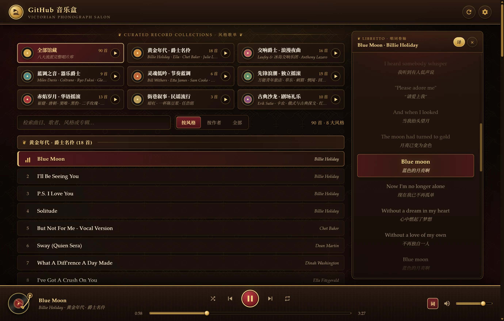
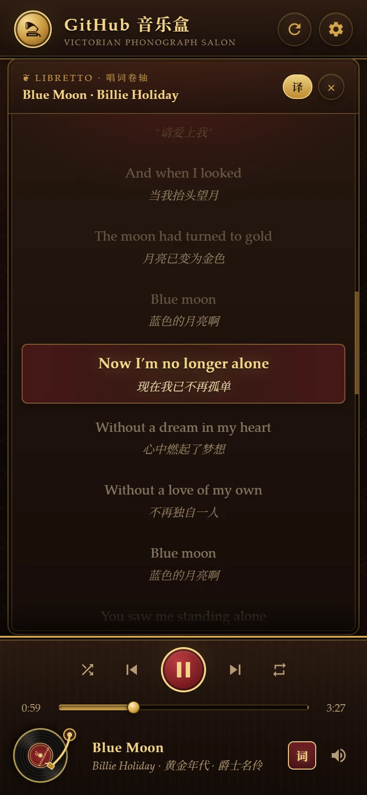

<div align="center">

# 🎺 GitHub 音乐盒 · Victorian Phonograph Salon

**一座架设在 GitHub Pages 上的维多利亚黑胶留声机沙龙**  
*零后端 · 无框架 · 自动解析标签与滚动唱词的云端私人唱片柜*

**简体中文** · [**English**](README_EN.md)

[](https://williamqaqq.github.io/music-box/)
[](music.json)
[](#-%E9%A6%86%E8%97%8F%E5%8D%81%E5%85%AB%E5%A4%A7%E9%A3%8E%E6%A0%BC%E4%B8%8E%E5%9B%BD%E6%AD%8C%E5%86%9B%E4%B9%90%E4%B8%93%E5%8C%BA)
[](lyrics.json)

### 👉 [立即进入在线留声机：https://williamqaqq.github.io/music-box/](https://williamqaqq.github.io/music-box/)

</div>

---

## ✨ 沙龙实景预览

<p align="center">
  
</p>

<details>
<summary>📱 展开查看移动端「唱词卷轴」实机画面</summary>
<br>
<p align="center">
  
</p>
</details>

---

## 🏛️ 核心特性

- **维多利亚黑胶留声机美学**：深邃锦缎暗纹壁纸、胡桃木镶嵌古铜机柜、随旋律旋转的黑胶唱盘与唱臂落针动画，支持桌面端双栏沙龙、iPad 平板双排播控适配与移动端抽屉布局。
- **十八大典藏唱片集与国歌军乐特辑**：全馆 **158 位音乐人、209 首曲目**，分为 **十一大沙龙流派** 与 **七大国歌军乐特辑（中、美、俄、法、德、日、英）**，顶部唱片架支持「全部 / 沙龙流派 / 国歌军乐」三级专区切换，支持一键「顺序起奏 / 随机起奏」，并可在 **按风格 / 按作者 / 全部** 三种视图间无缝切换。
- **双语时间轴滚动唱词（Libretto 唱词卷轴）**：
  - 全馆 **163 首人声与情景广播曲目**配备逐句同步 `.lrc` 时间轴唱词（其中 **117 首外语与多语种曲目全部内置双语译文**，可通过 `译` 按钮一键切换），**46 首纯音乐/氛围器乐曲目**展示专属器乐铭牌。
  - **随乐滚动 + 自由翻阅**：唱词随音乐平滑居中推进；当用户通过滚轮、触屏或滚动条主动翻阅时自动暂停跟随，并提供 **「↻ 回到当前唱词」** 按钮（或静置 5.5 秒自动恢复同步）。
  - **点句即达**：点击任意带时间轴的唱词行即可直接跳转至对应播放时刻。
- **零 API 限流 · 按需加载 · 离线 PWA 与智能预加载**：同源静态加载 [`music.json`](music.json) 结合 64-bit 指纹缓存实现秒开；[`lyrics.json`](lyrics.json) 改为播放曲目时按需延迟拉取，大幅节省冷启动首屏带宽；支持通过 [`sw.js`](sw.js) 与 [`manifest.webmanifest`](manifest.webmanifest) 启用支持 HTTP `Range` 续传的离线应用与音轨缓存；同时支持在右上角 **⚙️ 唱片柜设置** 中切换任意 GitHub 公开/私有仓库。
- **个人雅集 · 断点续播与分享直链**：
  - 顶部专设 **♥ 我的雅集**（我的珍藏 / 最近 45 首聆听足迹），列表行新增桃心收藏（或按 `F` 一键收藏），列表与队列抽屉采用 Keyed DOM 节点复用实现零闪烁更新；
  - 再次进入自动呈现 **上次聆听断点续播横幅** 一键接着听；支持复制带精准播放时间戳的 `#track=...&t=...` 分享直链直达某首歌曲的精彩瞬间。
- **留声机调音台与实用工具（快捷键 `E` / 右下角「调」）**：
  - **实时黄铜频谱与三段均衡器**：实时 Canvas 柱状峰值频谱（面板隐藏、滚动离屏或暂停时自动停帧节能），搭配 3 段复古 EQ（110Hz 低频 / 1.1kHz 中频 / 7.5kHz 高频）与五组调音预设（原声/暖箱/爵士/摇滚/人声），并支持调节黑胶与合成器混音浓淡；
  - **唱盘倍速 · Crossfade 与睡眠定时**：支持 `0.75x–1.5x` 变调不变速播放、2/4/6 秒曲间平滑过渡（Crossfade）、A-B 区间精听复读（`[` / `]` / `\`），以及播完本曲或 15/30/60 分钟最后 10 秒柔顺渐弱睡眠停播。
- **双语滚动唱词搜索与导出**：[`js/lyrics.js`](js/lyrics.js) 唱词面板新增**歌词内关键词检索**（`搜`）与**标准 `.lrc` 导出**（`导`，可选合并双语译文）。
- **交互式播放队列与快速检索**：列表每首曲目支持「`+` 下一首播放」，播放器右下角新增 **队列面板**（快捷键 `Q`）支持跳播、顶置下一首、移除、随机重排与清空后续；工具栏支持空格分词多关键词检索、一键清空与 **定位当前曲目**。
- **真实黑胶留声机音效模拟（Web Audio DSP）**：点击右下角 **「胶」** 按钮或轻按快捷键 `V` 即可一键开启/关闭（关闭后自动淡出并断开音效节点，零后台 CPU 空转）：
  - **复古频响塑造**：低频高通滤波去浊、180Hz 暖底增强与 6.8kHz 温润滚降，告别数码刺耳感；
  - **电子管/唱针饱和微失真**：融合对称 `tanh` 与微弱偶次谐波并精确 DC 归零，赋予音色丰满胆味温暖度；
  - **唱盘微颤与抖晃（Wow & Flutter）**：33.3 RPM 转速周期与微小电机震颤的微妙音高浮动，充满生动模拟呼吸感；
  - **真实唱针摩擦底噪与尘粒炒豆声（Crackle & Pops）**：程序化实时合成 6 秒等功率余弦交叉淡化无缝立体声底噪（零循环接缝杂音），并在开启时为落针唱臂附上金色微光。
- **模拟电子合成器音效（Web Audio Poly-Synth DSP）**：点击右下角 **「合」** 按钮或轻按快捷键 `S` 即可一键开启/关闭（关闭后自动停振 LFO 并断开支路，可与黑胶音效独立或叠加使用）：
  - **异步双 LFO 六级全通 PWM 相位梳状矩阵**：以两组异步正弦 LFO 交错反相调制 6 级纯线性高 Q 全通移相网络，构建模拟脉冲宽度调制（PWM）与弦乐合成器特有的宽广电子泛音结构，杜绝单相位扫频木讷感与非线性互调杂音；
  - **双共振峰雕刻与 24dB/oct 级联阶梯低通滤波器（Moog Ladder VCF）**：塑造 500Hz 与 1.28kHz 合成器电子共振峰与 7.4kHz 轻柔空气感高架，配合双级联 24dB/oct 谐振低通扫频滤波，彻底滤除高频毛刺；
  - **Juno-60 三声部正交复音合唱与带限丝绒回声**：经 3.8kHz 抗混叠柔化后进入左、中、右三路正弦 LFO 微失谐复音合唱（BBD Unison Ensemble）与 220Hz–1.9kHz 带限空间回声，将任意曲目纯净转化为复古模拟合成器演绎。
- **完备的播控与无障碍细节**：原生接入 `Media Session API`（支持键盘多媒体键、耳机线控与系统锁屏封面控播）、Fisher-Yates 真随机播放历史（点「上一首」能回到真正听过的歌）、三档循环（关闭 / 列表 / 单曲「1」角标）、移动端安全区与 44px 触控热区适配，以及连续失败熔断保护。

---

## 💿 馆藏十八大风格与国歌军乐专区

### 🎷 沙龙流派典藏 (11 大唱片集)

| 唱片集名称 | 代表音乐人 | 曲风导览 | 曲目数 |
| :--- | :--- | :--- | :---: |
| **古典沙龙 · 剧场礼乐** | Erik Satie · 肖邦/德彪西/贝多芬 · 卡鲁索/帕瓦罗蒂 · 红军合唱团 | 大提琴钢琴室内乐、旧日俄式及阿根廷探戈、恢弘合唱与庄重礼乐 | **19 首** |
| **黄金年代 · 爵士名伶** | Billie Holiday · Ella Fitzgerald · Chet Baker · Julie London | 1930–60 年代烟嗓名伶与摇摆黄金岁月，留声机最经典的温柔夜色 | **18 首** |
| **交响爵士 · 浪漫夜曲** | Laufey & 冰岛交响乐团 · Anthony Lazaro | 古典管弦乐团与现代爵士女声的浪漫交织，宛如烛光音乐厅现场 | **16 首** |
| **先锋浪潮 · 独立摇滚** | 万能青年旅店 · 草东没有派对 · 刺猬 · 惘闻 · 回春丹 | 当代华语独立乐队、后摇器乐与合成器浪潮，锋利诗意的新声 | **15 首** |
| **赤焰岁月 · 华语摇滚** | 崔健 · 唐朝 · 窦唯 · 黑豹 · 二手玫瑰 · 罗大佑 | 华语摇滚开山火种与时代呐喊，粗粝炽热的经典现场记忆 | **13 首** |
| **世界民谣 · 万国乡音** | Simon & Garfunkel · The Animals · Eva Cassidy · Milva · Yves Montand | 横跨五大洲十二国的经典原声录音室名盘：英格兰、爱尔兰、苏格兰、法、德、意、古、墨、美、中、日、韩传世名录 | **12 首** |
| **暗夜怪谈 · 模拟恐怖** | The Caretaker · Boards of Canada · 山冈晃 · Local 58 · Kane Pixels | 阈值空间、怀旧幽灵舞厅与诡谲梦核：《后室》与《寂静岭》名曲、数字电台、1961 语音合成与战前老唱片 | **22 首** |
| **流金热浪 · 时代新声** | Billie Eilish · Lady Gaga & Bruno Mars · ROSÉ · Kendrick Lamar · 温奕心 | 近年风靡全球榜单与中文流行热单，兼具流金旋律与现代编曲质感 | **10 首** |
| **蓝调之音 · 器乐爵士** | Miles Davis · John Coltrane · Ryo Fukui · Glenn Miller | 小号、萨克斯与钢琴三重奏的深夜即兴，兼具冷爵士与大乐队摇摆 | **9 首** |
| **灵魂低吟 · 节奏蓝调** | Bill Withers · Etta James · Sam Cooke · 陶喆 | 深情滚烫的灵魂乐与节奏布鲁斯经典，直抵人心的律动与嘶吼 | **6 首** |
| **街巷叙事 · 民谣流行** | Вадим Казаченко · 暗杠 · 一杯陈豆浆 · 任浩铭 | 温润质朴的城市民谣与复古流行抒情金曲，适合静夜独酌的街巷故事 | **4 首** |

### 🎺 国歌军乐特辑 (7 国军旅典章)

| 专区国家 | 代表曲目 | 题材导览 | 曲目数 |
| :--- | :--- | :--- | :---: |
| 🇨🇳 **国歌军乐 · 中国** | 义勇军进行曲 · 东方红 · 八路军进行曲 · 歌唱祖国 · 保卫黄河 | 庄严雄壮的国家颂歌、抗战延安原始录音、黄河大合唱与革命军旅进行曲 | **10 首** |
| 🇺🇸 **国歌军乐 · 美国** | 星条旗之歌 · 星条旗永不落 · 永远忠诚 · 华盛顿邮报 · 自由钟 · 起锚歌 | 约翰·菲利普·苏萨铜管经典、海军学院学员合唱与各兵种军旅颂歌 | **10 首** |
| 🇷🇺 **国歌军乐 · 俄罗斯** | 牢不可破的联盟 · 神圣的战争 · 告别斯拉夫少女 · 华沙工人歌 · 热情者进行曲 | 红旗歌舞团合唱、伟大卫国战争记忆、工业建设赞歌与古典军旅行进曲 | **10 首** |
| 🇫🇷 **国歌军乐 · 法国** | 马赛曲 · 出征之歌 · 游击队之歌 · 洛林进行曲 · 桑布尔与默兹进行曲 | 法兰西大革命激昂号角、帝国第二国歌、二战抵抗运动与近卫军合唱 | **10 首** |
| 🇩🇪 **国歌军乐 · 德国** | 德意志之歌 · 艾丽卡 · 普鲁士荣誉 · 旧友进行曲 · 柯尼希格雷茨 · 莱茵河卫兵 | 古典欧洲军乐体系代表作、海顿旋律、传统步兵行军歌与仪仗铜管乐 | **10 首** |
| 🇯🇵 **国歌军乐 · 日本** | 君之代 · 军舰进行曲 · 分列行进曲 · 雪中行军 · 露营之歌 · 敷岛舰 | 明治与昭和初期历史黑胶唱片经典行进军乐、军乐团合唱与雅乐国歌 | **10 首** |
| 🇬🇧 **国歌军乐 · 英国** | 天佑吾王 · 统治吧不列颠尼亚 · 掷弹兵进行曲 · 博吉上校 · 希望与荣耀之地 | 掷弹兵近卫军乐队、爱德华时代女高音录音与皇家海军传世战歌 | **5 首** |

---

## ⌨️ 快捷键一览

| 按键 | 功能 | 按键 | 功能 |
| :---: | :--- | :---: | :--- |
| `Space` | 播放 / 暂停 | `N` / `P` | 下一首 / 上一首 |
| `←` / `→` | 快退 / 快进 5 秒 | `M` | 静音 / 恢复音量 |
| `↑` / `↓` | 音量增加 / 减小 5% | `L` / `Esc` | 展开或收起滚动唱词面板 |
| `V` | 切换黑胶留声机音效模拟 | `S` | 切换电子合成器音色重合成 |
| `E` | 打开留声机调音台与工具 | `F` | 收藏 / 取消收藏当前曲目 |
| `Q` | 展开或收起播放队列抽屉 | `[` / `]` / `\` | 设 A-B 复读起点 / 终点 / 清除 |
| `Esc` | 关闭当前浮层、调音台或设置 | | |

---

## 📦 日常加歌与自动化部署

本项目纯静态无构建步骤，新增音乐只需将音频文件（支持 `.mp3` / `.m4a` / `.flac` / `.ogg` / `.wav` 等，可选附带同名 `.lrc` 歌词或目录封面图）放入 [`music/`](music) 目录并推送：

```bash
git pull --rebase
git add .
git commit -m "music: 新增曲目"
git push
```

推送后，GitHub Actions 工作流 [`.github/workflows/update-music.yml`](.github/workflows/update-music.yml) 会自动运行 [`.github/gen_music_json.py`](.github/gen_music_json.py)：
1. 通过 `mutagen` 自动读取音频内嵌 ID3 歌手、专辑、曲名、流派与内嵌歌词标签，归入对应风格歌单；
2. 自动为新增曲目检索匹配时间轴 `.lrc` 滚动歌词；
3. 自动提交更新 [`music.json`](music.json) 与 [`lyrics.json`](lyrics.json) 并触发 GitHub Pages 重新发布，刷新网页即可收听。

### 连接个人 Cloudflare R2 曲库或复刻你自己的仓库
- **Cloudflare R2 扩容网关**：除 GitHub 仓内基础馆藏外，现支持「**GitHub + R2 混排 / 仅 R2 / 仅 GitHub**」三档音源切换；配套只读网关 Worker（[`cloudflare-r2/src/worker.js`](cloudflare-r2/src/worker.js)）强制 `Origin`/`Referer` 来源白名单、路径扩展名消毒与 HTTP `206 Range` 断点拖动，并通过 [`cloudflare-r2/sync_r2.py`](cloudflare-r2/sync_r2.py) 自动增量上传本地 `r2_music/` 音频、提取 ID3 标签并匹配滚动歌词。
- **临时切换音源**：打开播放器右上角 **⚙️ 唱片柜设置**，可切换音源模式、填入自己的 Cloudflare R2 Worker 地址（若 Worker 设了 `ACCESS_KEY` 也可填访问口令），或任意 GitHub `Owner` / `Repo`（所有密钥仅存于本地浏览器 `localStorage`）。
- **Fork 部署个人站点**：Fork 本仓库 → 替换 [`music/`](music) 中的音频并在 [`js/catalog-data.js`](js/catalog-data.js) / [`js/library-loader.js`](js/library-loader.js) 修改默认仓库或网关 → 在仓库 `Settings → Pages` 开启 `Deploy from a branch (main / root)` 即可拥有同款私人黑胶音乐馆。

---

## 🗂️ 仓库结构

```text
music-box/
├── README.md                       # 仓库中文展示主页
├── README_EN.md                    # 仓库英文展示主页 (English README)
├── index.html                      # 播放器页面结构（维多利亚沙龙双栏、调音台浮层与队列抽屉）
├── style.css                       # 复古黑胶留声机主题样式、安全区与响应式触控布局
├── manifest.webmanifest            # PWA 应用安装清单
├── sw.js                           # Service Worker（外壳 SWR 与音轨 Range 离线缓存）
├── app.js                          # 主控编排（筛选、Keyed DOM 队列、预加载、Crossfade 与快捷键）
├── js/
│   ├── catalog-data.js             # 流派映射常量、FNV-1a 指纹、分享链接编解码、LRC 导出与检索工具
│   ├── user-state.js               # 个人状态控制器（收藏、最近聆听、断点续播、睡眠定时、A-B 复读）
│   ├── library-loader.js           # 曲库加载与设置弹窗管理器（music.json / GitHub API 兜底）
│   ├── audio-fx.js                 # Web Audio DSP（黑胶 & 合成器、3 段 EQ、频谱 Analyser 与总线淡出）
│   ├── lyrics.js                   # LRC 时间轴解析、按需延迟加载、歌词检索与 .lrc 导出引擎
│   └── studio-ui.js                # 留声机调音台浮层（Popover API、实时频谱、EQ、倍速、定时与分享）
├── tests/                          # Node 单元测试与 Playwright 端到端测试套件
├── cloudflare-r2/                  # Cloudflare R2 只读防盗链 Worker 网关与增量上传同步脚本
├── music.json                      # 曲目主清单（标题 / 歌手 / 专辑 / 风格 / 相对路径）
├── lyrics.json                     # 全馆时间轴滚动歌词库（原文 / 双语译文 / 器乐标记）
├── music/                          # 馆藏音频文件目录（当前 209 首）
├── AGENTS.md                       # 项目技术细节与维护交接文档
└── .github/
    ├── assets/                     # README 实机预览截图
    ├── gen_music_json.py           # ID3 标签扫描、流派归类与在线歌词生成脚本
    └── workflows/update-music.yml  # Push 音乐后自动更新清单的 GitHub Actions 工作流
```
