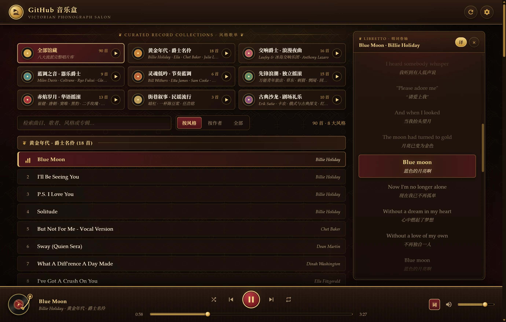
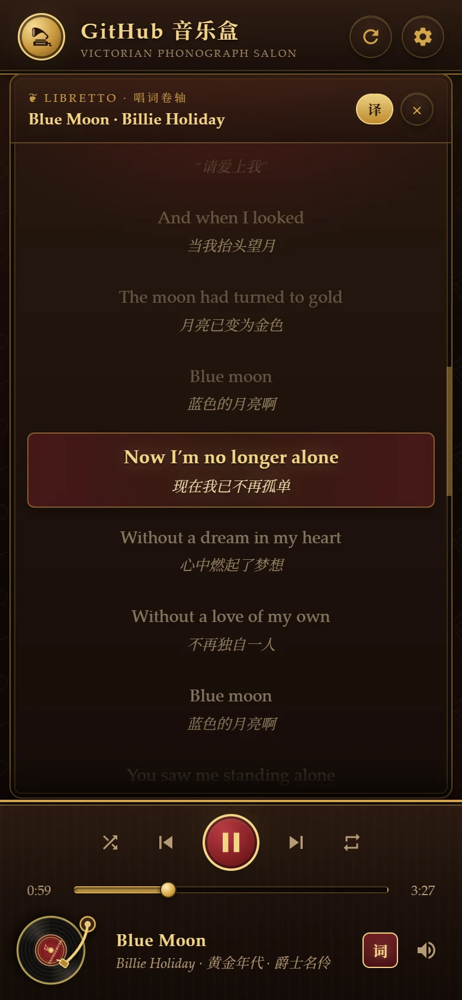

<div align="center">

# 🎺 GitHub Music Box · Victorian Phonograph Salon

**A Victorian Vinyl Gramophone Salon Hosted on GitHub Pages**  
*Zero Backend · Framework-Free · Automated ID3 Tag & Synced LRC Lyrics Cloud Record Cabinet*

[**简体中文**](README.md) · **English**

[](https://williamqaqq.github.io/music-box/)
[](music.json)
[](#-curated-record-collections)
[](lyrics.json)

### 👉 [Enter the Live Phonograph Salon: https://williamqaqq.github.io/music-box/](https://williamqaqq.github.io/music-box/)

</div>

---

## ✨ Salon Preview

<p align="center">
  
</p>

<details>
<summary>📱 Click to expand Mobile "Libretto Scroll" Preview</summary>
<br>
<p align="center">
  
</p>
</details>

---

## 🏛️ Key Highlights

- **Victorian Vinyl Gramophone Aesthetic**: Damask wallpaper motifs, walnut-and-brass cabinet framing, a spinning vinyl platter with an animated dropping tonearm, and a responsive layout that adapts from a two-column desktop salon to a slide-up mobile drawer.
- **15 Curated Record Collections & National Anthem Editions**: **166 tracks across 118 artists**, organized into 8 salon genres and 7 dedicated National Anthem & Military March editions (China, USA, Russia, France, Germany, Japan, United Kingdom). The shelf features an interactive "All / Salon Genres / Anthems & Marches" sub-filter, supports single-click sequential and shuffle playback, and seamlessly switches between **By Genre / By Artist / All Tracks** views.
- **Time-Synced Scrolling Lyrics (Victorian Libretto Folio)**:
  - **129 tracks** feature line-by-line `[mm:ss.xx]` `.lrc` synchronized lyrics (**all 89 foreign-language vocal tracks include bilingual Chinese translations**, toggleable via the `译` button), while **37 instrumental tracks** display a dedicated `INSTRUMENTAL` plaque.
  - **Auto-Scroll + Free Manual Browsing**: Lyrics smoothly center on the active line as the music plays. Scrolling manually via mouse wheel, touch, keyboard, or scrollbar automatically pauses auto-follow and surfaces a **"↻ Return to Current Line"** button (or auto-resumes after 5.5 seconds of inactivity).
  - **Click-to-Seek**: Click any timestamped lyric line to jump straight to that moment in the recording.
- **Zero API Rate Limits · Instant Load & Hot Refresh**: Reads same-origin static manifests ([`music.json`](music.json) and [`lyrics.json`](lyrics.json)) paired with `localStorage` caching for instant startup and silent background refreshes. Also supports pointing to any public or private GitHub repository via the top-right **⚙️ Cabinet Settings** modal (falling back to the GitHub Trees API).
- **Realistic Vinyl Record Emulation (Web Audio DSP)**: Toggle with a single click (shortcut `V` or the **"胶"** button in the player bar) to experience authentic vintage phonograph acoustics via real-time Web Audio DSP:
  - **Vintage Frequency Shaping**: High-pass low-end cleanup, +2.2dB warm low-shelf richness, and a 6.8kHz smooth roll-off eliminating digital sibilance;
  - **Tube / Cartridge Saturation**: Soft-clipping transfer curve introducing warm even & odd analog harmonics;
  - **Turntable Pitch Drift (Wow & Flutter)**: 33.3 RPM cyclical speed drift (0.555 Hz) and mechanical motor jitter for an unmistakably human, organic vinyl breathing;
  - **Surface Noise & Crackles**: Procedurally synthesized 8-second stereo groove friction rumble with dust crackles and pops ("炒豆声"), illuminating the tonearm with a warm golden needle glow when active.
- **Analog Poly-Synthesizer Emulation (Web Audio Poly-Synth DSP)**: Toggle via the **"合"** button or shortcut `S` (works independently or stacked with Vinyl mode):
  - **6-Stage High-Q Allpass PWM Comb Matrix**: A 6-stage pure linear allpass phase-dispersion cascade mixed 50%/50% with the dry signal sculpts deep Pulse-Width Modulation (PWM) and string-synth harmonic comb notches with zero nonlinear intermodulation noise;
  - **Dual Formant Sculpting & 24dB/oct Cascaded Moog Ladder VCF**: Shapes 500Hz and 1.28kHz electronic synth formants into a dual-cascaded 24dB/oct resonant low-pass filter swept smoothly by a sine LFO;
  - **3-Voice Juno-60 Unison Ensemble Chorus & Velvet Echo**: Pre-filtered at 3.8kHz into left, right, and center pitch-detuned BBD unison voices plus a band-limited (220Hz–1.9kHz) space echo for a lush, noise-free retro synth transformation.
- **Refined Playback Engineering**: Native `Media Session API` integration (hardware media keys, headphone controls, OS lock-screen artwork), true Fisher-Yates shuffle history (`Previous` returns to the actual track you just heard), 3-mode repeat (`Off / All / One`), and automatic skip-circuit-breaker on network errors.

---

## 💿 Curated Record Collections (15 Editions)

### 🎷 Salon Genres (8 Collections)

| Collection | Featured Artists | Curatorial Notes | Tracks |
| :--- | :--- | :--- | :---: |
| **古典沙龙 · 剧场礼乐**<br>*(Classical Salon & Tango)* | Erik Satie · Pachelbel's Canon · Chopin / Debussy / Beethoven · Caruso / Pavarotti · Red Army Choir | Chamber cello & piano, vintage Russian and Argentine tangos, and choral marches | **20** |
| **黄金年代 · 爵士名伶**<br>*(Golden Era Vocal Jazz)* | Billie Holiday · Ella Fitzgerald · Chet Baker · Julie London | 1930s–60s smoky jazz divas, crooners, and velvet swing standards | **18** |
| **交响爵士 · 浪漫夜曲**<br>*(Symphonic & Night Jazz)* | Laufey & Iceland Symphony Orchestra · Anthony Lazaro | Contemporary vocal jazz interwoven with lush orchestral arrangements | **16** |
| **先锋浪潮 · 独立摇滚**<br>*(Indie Rock & Post-Rock)* | Omnipotent Youth Society · No Party For Cao Dong · Hedgehog · Wang Wen | Contemporary Chinese indie bands, post-rock instrumentals, and synth-wave | **15** |
| **赤焰岁月 · 华语摇滚**<br>*(Chinese Rock Pioneers)* | Cui Jian · Tang Dynasty · Dou Wei · Black Panther · Second Hand Rose · Lo Ta-yu | Foundational anthems and raw live energy from the golden age of Chinese rock | **13** |
| **蓝调之音 · 器乐爵士**<br>*(Instrumental Jazz & Cool Bop)* | Miles Davis · John Coltrane · Ryo Fukui · Glenn Miller | Late-night trumpet, saxophone, and piano trio improvisations & big band swing | **9** |
| **灵魂低吟 · 节奏蓝调**<br>*(Classic Soul & R&B)* | Bill Withers · Etta James · Sam Cooke · David Tao | Warm, heartfelt soul classics, blues ballads, and rhythm & blues grooves | **6** |
| **街巷叙事 · 民谣流行**<br>*(Urban Folk & Ballads)* | Vadim Kazachenko · Angang · Chen Doujiang · Ren Haoming | Intimate acoustic storytelling, retro Estrada & folk-pop ballads | **4** |

### 🎺 National Anthems & Military Marches (7 Nations)

| Country Edition | Featured Tracks | Highlights | Tracks |
| :--- | :--- | :--- | :---: |
| 🇨🇳 **国歌军乐 · 中国**<br>*(China Anthems & Marches)* | March of the Volunteers · The East Is Red · March of 8th Route Army · Defend the Yellow River | Historic brass band anthem, 1939 Yan'an battle recordings, Yellow River Cantata & revolutionary marches | **10** |
| 🇺🇸 **国歌军乐 · 美国**<br>*(USA Anthems & Marches)* | The Star-Spangled Banner · Semper Fidelis · The Washington Post · The Liberty Bell · Anchors Aweigh | John Philip Sousa ceremonial brass marches, USNA choir chorales & Armed Forces hymns | **10** |
| 🇷🇺 **国歌军乐 · 俄罗斯**<br>*(Russia & Soviet Marches)* | State Anthem of the USSR · The Sacred War · Farewell of Slavianka · Warszawianka · March of Enthusiasts | Powerful Red Army Choir recordings, industrial youth anthems & heroic military marches | **10** |
| 🇫🇷 **国歌军乐 · 法国**<br>*(France Anthems & Marches)* | La Marseillaise · Le Chant du départ · Le Chant des Partisans · Sambre-et-Meuse | French Revolutionary brass fanfares, First Empire anthem & Garde Républicaine chorus | **10** |
| 🇩🇪 **国歌军乐 · 德国**<br>*(Germany Traditional Marches)* | Das Lied der Deutschen · Erika · Preußens Gloria · Alte Kameraden · Königgrätzer · Wacht am Rhein | Classical European ceremonial brass repertoire, marching soldier songs & Prussian infantry brass | **10** |
| 🇯🇵 **国歌军乐 · 日本**<br>*(Japan Ceremonial Marches)* | Kimigayo · Gunkan Kōshinkyoku · Review March · Yuki no Shingun · Roei no Uta | Vintage Meiji/Taisho/Showa 78 RPM gramophone brass marches, military choirs & imperial anthem | **10** |
| 🇬🇧 **国歌军乐 · 英国**<br>*(UK Anthems & Marches)* | God Save the King · Rule, Britannia! · The British Grenadiers · Colonel Bogey · Land of Hope and Glory | Band of the Grenadier Guards, Edwardian diva Clara Butt 78 RPM & Royal Navy war standards | **5** |

---

## ⌨️ Keyboard Shortcuts

| Key | Action | Key | Action |
| :---: | :--- | :---: | :--- |
| `Space` | Play / Pause | `N` / `P` | Next / Previous track |
| `←` / `→` | Seek backward / forward 5s | `M` | Mute / Unmute |
| `↑` / `↓` | Volume +5% / -5% | `L` / `Esc` | Toggle / Close scrolling lyrics panel |
| `V` | Toggle vinyl record emulation | `S` | Toggle synthesizer resynthesis |

---

## 📦 Adding Music & Automated Workflow

This project is 100% static with zero build steps. To add new tracks, simply drop audio files (`.mp3`, `.m4a`, `.flac`, `.ogg`, `.wav`, etc., optionally alongside matching `.lrc` files or folder cover images) into [`music/`](music) and push:

```bash
git pull --rebase
git add .
git commit -m "music: add new tracks"
git push
```

Once pushed, the GitHub Actions workflow [`.github/workflows/update-music.yml`](.github/workflows/update-music.yml) automatically runs [`.github/gen_music_json.py`](.github/gen_music_json.py) to:
1. Extract embedded ID3 artist, album, title, genre, and `USLT` lyrics tags via `mutagen` and assign the track to its curated style collection;
2. Search and match time-synced `.lrc` lyrics online for newly added songs;
3. Commit the updated [`music.json`](music.json) and [`lyrics.json`](lyrics.json) back to `main` and trigger a GitHub Pages deployment.

### Connect Your Own Repository or Fork
- **Switch Source on the Fly**: Click **⚙️ Cabinet Settings** in the top-right corner of the player and enter any GitHub `Owner` and `Repo` (plus an optional `ghp_` token stored only in your browser's `localStorage` for private repositories).
- **Deploy Your Own Salon**: Fork this repository → replace tracks in [`music/`](music) and update `DEFAULT_SETTINGS` in [`app.js`](app.js) → enable GitHub Pages (`Deploy from a branch: main / root`) in your repository settings.

---

## 🗂️ Repository Structure

```text
music-box/
├── README.md                       # Chinese repository showcase homepage
├── README_EN.md                    # English repository showcase homepage
├── index.html                      # Player markup (Victorian 2-column salon & Libretto folio)
├── style.css                       # Victorian vinyl gramophone theme & responsive styles
├── app.js                          # Playback, genre filtering, search & LRC scrolling lyrics engine
├── music.json                      # Track manifest (title / artist / album / genre / relative path)
├── lyrics.json                     # Synced LRC lyrics catalog (lyrics / translations / instrumental flags)
├── music/                          # Audio files directory (currently 166 tracks)
├── AGENTS.md                       # Technical architecture & maintainer handover notes
└── .github/
    ├── assets/                     # High-DPI WebP preview screenshots for README
    ├── gen_music_json.py           # ID3 tag scanner, genre classifier & online lyrics fetcher
    └── workflows/update-music.yml  # GitHub Actions workflow triggered on music/** pushes
```
